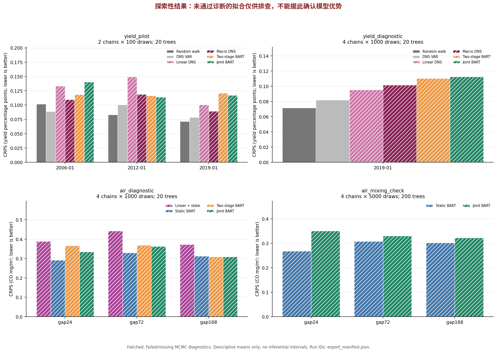
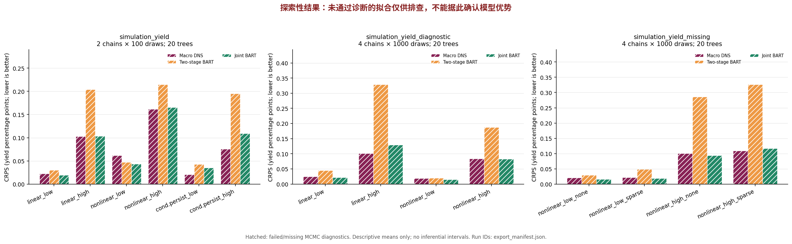

# BART＋状态空间：首轮实验与选题取舍

日期：2026-10-22。范围：代码与推断管线验证、模拟筛查、验证集小规模试跑。**尚无通过全部多链诊断的贝叶斯模型比较，不能据此宣布预测改进或创新成立。** 确认集没有用于拟合、调参或评分。

最终选定九个完整执行的探索配置，共 130 个 case/model 分数，其中八个是 MCMC 不适用的插件基线，其余 122 个均未通过已记录的诊断。延长空气质量抽样并增加树数后，联合模型在三种停测长度上的 CRPS 均高于静态 BART；短配置中的局部优势没有稳定保留。当前最有价值的交付是可审计的基线、失败证据和下一步应检验的条件，而非一项已经验证的预测贡献。

## 1. 本轮实际完成了什么

仓库现在可以从固定数据快照运行两个场景的基线、联合模型、评分和报告。官方 Fed GSW、FRED、UCI 已可访问，原计划中的总工业产能利用率 TCU 已替换临时 CUMFNS 镜像代理，数据来源及 SHA-256 已固定。早期镜像结果保留，不与官方版本合并。

收益率模型包括随机游走、完整 VAR-DNS、对角动态的线性 DNS、线性宏观 DNS、匹配的两阶段宏观 BART、联合 M0。空气质量模型包括静态 BART、线性校准＋动态偏差、固定 BART 后验均值＋残差 AR(1)、联合 BART＋AR(1)。首版空气模型固定 rho=0.99，收益率固定 NS lambda=0.0609/月；这些是本轮实验约束，尚未完成参数敏感性研究。

本轮没有运行完整的 2005—2019 年逐月回测。官方收益率 pilot 只检查 2006-01、2012-01、2019-01 三个预测目标月；较长链只检查 2019-01。空气质量使用 2004 年 11—12 月验证段。确认段分别为 2020—2024 年和 2005 年剩余区间。收益率使用当前修订值及保守发布滞后，因此只能称为伪样本外预测。

运行账本、逐配置分数和诊断摘要见 [小型结果存档](../results/first_round/)。各运行的原始输入、源码快照、后验样本、逐观测评分、退出状态及日志保存在本地忽略目录 `artifacts/`。Git 中只保存小型结果；已有缓存可以离线重跑。官方地址未来更新导致校验值变化时，需要明确建立新版本，不能静默替换数据。

## 2. 代码正确性与研究有效性分别验收

| 检查 | 本轮结果 | 可以得出的判断 |
|---|---|---|
| Kalman／FFBS 与独立稠密高斯条件分布比较 | 均值、协方差和抽样检查通过；含缺失观测 | 状态抽样在线性高斯特例下正确 |
| 原生 C 加速与 R 实现 | 24 个额外随机案例最大误差约 1.14e-13；RNG、退化情形回退及强制 GC 检查通过 | 加速没有改变被验证的状态更新 |
| 持久 dbarts、offset、固定尺度 | 连续抽样与分段抽样逐值一致；offset 与响应尺度检查通过 | 未发现重新设响应或重启树链造成的先验／采样错误 |
| 时序和缺失边界 | 未来／隐藏参考值不改变已评分预测；缺失输入跳过更新；封存目标被拒绝 | 当前在线评分没有使用停测结束后的标签反向平滑 |
| 来源和执行固定 | 配置、输入、源码和原生库快照带哈希；并发编辑回归检查通过 | 后续运行不会读取执行中被编辑的脚本 |
| 后验诊断 | 关键参数或函数量仍出现 Rhat 超阈值、ESS 不足 | **数值可运行不等于后验结果可靠** |

命令为 `python3 scripts/run.py test`。检查包含五组 R 数值／模型／预测诊断测试及 Python 数据、报告、运行快照测试；不会用零测试或语法检查替代数值验证。诊断门槛采用 Rhat < 1.01 且 bulk/tail ESS ≥ 400。固定插件估计的随机游走、VAR-DNS 标记为“MCMC 不适用”，不计入收敛通过数。

本轮收尾补充了代表位置的条件预测均值和预测观测抽样诊断，并在两个真实场景重新验证接线。它们与参数诊断共同构成新运行的门槛；不能把早期只有参数／训练函数诊断的运行追认为完整通过。代表位置也不代表整个函数曲面的收敛性。

## 3. 空气质量：有研究线索，但尚不能归因于联合估计

以下是四链、每链预热 1,000 次并保留 1,000 次、20 棵树的验证集描述性结果。CO 的单位为 mg/m³；RMSE、CRPS 和区间宽度同单位。所有下列贝叶斯模型均未通过完整诊断。

| 停测小时 | 模型 | RMSE | CRPS | 95% 覆盖率 | 95% 宽度 |
|---:|---|---:|---:|---:|---:|
| 24 | 静态 BART | 0.6310 | 0.2923 | 0.8256 | 1.3280 |
| 24 | 联合 BART＋AR(1) | 0.6912 | 0.3353 | 0.8897 | 1.5847 |
| 72 | 静态 BART | 0.6688 | 0.3297 | 0.8217 | 1.3187 |
| 72 | 联合 BART＋AR(1) | 0.7202 | 0.3633 | 0.8867 | 2.1221 |
| 168 | 静态 BART | 0.6352 | 0.3131 | 0.8300 | 1.3146 |
| 168 | 固定 BART＋残差 AR(1) | 0.6172 | 0.3097 | 0.8988 | 1.9508 |
| 168 | 联合 BART＋AR(1) | 0.6066 | 0.3093 | 0.9575 | 2.5253 |

24／72／168 小时方案分别有 12／12／5 个可评分停测块，评分小时数为 281／847／800。验证段共 1,464 小时，其中 1,384 小时输入完整，1,240 小时同时有完整输入和 CO 真值；训练段 5,646 小时中有 4,092 小时可用于校准。停测评分数是各自观测计划的覆盖，并非整个验证段的传感器完整率。不同停测长度选择的区间并不完全相同，不能将表中变化解释成“停测更久导致联合收益更大”。同一长度内四模型使用相同掩码，停测之间至少留 24 小时恢复参考观测。168 小时只有五块，不能可靠估计误差差异区间。

在这组短配置中，联合模型的区间覆盖率提高伴随着区间变宽；其短停测 RMSE 和 CRPS 更差，长停测 CRPS 与两阶段模型很接近。因收敛未通过，以上只用于发现应检验的问题。联合模型与空气两阶段模型的区别还包含第一阶段函数不确定性传播，不能将差异全部归因于状态向树模型的反馈。

随后完成的 **200 棵树、四链、每链预热／保留各 5,000 次** 的真实数据敏感性运行给出相反的长停测排序：

| 停测小时 | 静态 BART CRPS | 联合 BART CRPS |
|---:|---:|---:|
| 24 | 0.2683 | 0.3503 |
| 72 | 0.3077 | 0.3306 |
| 168 | 0.3023 | 0.3225 |

这次运行约 1,038 秒；静态模型最大 Rhat=1.354、最小 bulk ESS=9.36，联合模型分别为 1.759 和 6.06，均不合格。长配置没有稳定保留短配置的长停测优势；它也没有提供足以可靠比较模型的后验抽样。不能把“运行更久”写成“已经收敛”。



模拟也没有给出稳定的胜负：四链 1,000 次配置中，有漂移的两次重复中联合模型 CRPS 较低，但慢变协变量的两次重复中较高；无漂移时方向不一致。增加到 200 棵树和每链预热／保留各 5,000 次后，部分排序又变化。树数与抽样长度同时改变，不能把这些变化单独归因于某一个设置。不同配置完整存档，不选择性保留有利结果。

直接调用 dbarts 的不间断长链也复现了混合缓慢；200 棵树、预热 5,000 次、保留 10,000 次的独立无漂移审计仍约有最大 Rhat=1.077、最小 bulk ESS=38.5。逐步调用接口不是目前找到的原因。真实数据中函数与终点偏差的相关、状态方差的高自相关，提示静态非线性函数与持续偏差的分离值得研究，但尚不能证明存在物理老化或特定不可识别机制。

## 4. 收益率：先验证非线性信息与噪声条件，暂不加 M1

官方 TCU 数据、2019-01 单个目标月、四链 1,000 次配置的结果如下。单位为年化收益率的百分点；六个期限不是六个独立时间重复。

| 模型 | RMSE | CRPS | 95% 宽度 | 最大 Rhat / 最小 bulk ESS |
|---|---:|---:|---:|---|
| 随机游走 | 0.0646 | 0.0715 | 1.1017 | 不适用 |
| 完整 VAR-DNS | 0.1080 | 0.0819 | 1.0827 | 不适用 |
| 线性 DNS | 0.0472 | 0.0955 | 1.5792 | 1.235 / 13.2 |
| 线性宏观 DNS | 0.0795 | 0.1017 | 1.6231 | 1.789 / 6.2 |
| 两阶段宏观 BART | 0.1256 | 0.1102 | 1.6040 | 1.112 / 31.9 |
| 联合 M0 | 0.1458 | 0.1126 | 1.5694 | 1.611 / 7.0 |

这个月份没有显示宏观 BART 优于简单基线；单月和未收敛结果既不能支持，也不足以否定长期非线性预测信息。插件 VAR 与联合对角模型还存在参数不确定性和动态约束差异，不能仅根据这一行间比较判断 BART 的作用。

非线性模拟使用相同潜在路径，改变观测噪声和期限缺失；低／高噪声及无／稀疏缺失采用共同随机数。下表是单次重复的状态恢复 RMSE，仍全部未通过完整诊断。

| 观测条件 | 线性宏观 DNS | 两阶段 BART | 联合 M0 |
|---|---:|---:|---:|
| 低噪声，无缺失 | 0.0541 | 0.0806 | 0.0507 |
| 低噪声，稀疏缺失 | 0.0603 | 0.1470 | 0.0546 |
| 高噪声，无缺失 | 0.3569 | 0.8061 | 0.2495 |
| 高噪声，稀疏缺失 | 0.5079 | 1.4701 | 0.4565 |

初步模式是：固定 OLS 因子的两阶段模型对观测噪声和期限缺失更敏感，联合模型并没有稳定超过线性宏观联合模型。例如高噪声且稀疏缺失时，联合 M0 的一步 CRPS 为 0.1167，线性宏观 DNS 为 0.1092。这正是需要保留的反例：状态恢复与预测不是同一目标，联合估计与非线性贡献也需要分别识别。



稀疏缺失每个月最多删除两个期限，初始化仍要求至少三个可识别期限。整月缺失尚不支持。本轮也包含条件持续性的数据生成情形，但拟合对照仍为常系数 M0；它只是失配压力测试，**不是条件持续性存在与否的识别检验**，不据此启动完整 M1。

## 5. 失败记录、区间评价和证据边界

两次早期收益率运行在写出部分／全部分数后，因运行期间主脚本被编辑而发生增量解析错误，退出码为 1。旧的收益率模拟还没有在噪声水平间共享同一潜在路径。两次运行及日志保留在账本，排除科学比较；随后修复为从不可变源码、数据和原生库快照执行，并重跑 canonical 数据与配对模拟。不能因为错误前存在 CSV 就把它们标记为成功。

报告器按真实时间块、停测块或模拟重复组织误差差异，不把相邻小时或同一曲线上的期限当作独立样本。当前诊断未通过，且收益率目标月份和模拟重复数过少，因此不发布具有推断含义的差异置信区间。预测覆盖率、宽度和 CRPS 保留为描述性检查。所有比较都包括负面结果。

可见材料包括组会项目历史对话，但未取得原始提案／PPT 附件、完整旧代码及导师反馈。M0 在 DNS 潜在因子转移中加入宏观 BART 漂移，M1 进一步让持续性随宏观变量变化；本次使用的具体约束和先验属于本轮实验选择，不能写成已获导师认可的结论。本轮文献定位以可核验的原论文为依据。BAVART、MF-BAVART、VCBART 和 regime-DNS 已分别覆盖相关非线性动态、潜在变量、变系数树与状态／结构联合估计思想，不能把“BART＋FFBS”本身作为创新。

## 6. 选题清单与下一轮最小工作

| 取舍 | 方向 | 证据及下一道门槛 |
|---|---|---|
| **保留，优先作为主选题候选** | 间歇参考观测下，非线性传感器校准与持续偏差的可分离条件及预测不确定性 | 实际停测任务清楚、参考真值可用；目前的配置敏感和混合问题使“何时能可靠分离”比预设提升更合适。先通过诊断，再比较匹配停测块 |
| **保留，作为备选题** | 观测噪声与期限缺失如何影响宏观非线性 DNS 的联合估计价值 | 模拟提示两阶段状态误差会放大，但线性联合模型已经解释部分收益；必须检验超出线性平滑的额外价值 |
| **修改** | 宏观非线性预测收益率 | 改为“是否存在及在哪些宏观环境存在”的可反证问题；目前单月没有改善，不能写成已知贡献 |
| **修改** | 联合反馈的独立贡献 | 增加传播函数不确定性但切断状态反馈的对照；当前空气两阶段固定函数均值，不足以独立归因 |
| **暂缓** | 完整 M1／变系数树／条件持续性 | 先解决 M0 的抽样和可识别性，再开展固定环境内冲击衰减的模拟与匹配对照 |
| **暂缓** | 正式确认集与大规模滚动回测 | 未通过诊断前扩大回测不会修复推断质量；确认集继续封存 |

主选题的暂定表述为：**“间歇参考观测下的贝叶斯非线性动态校准：函数—偏差分离与不确定性评价”**。备选表述为：**“噪声与期限缺失下宏观非线性收益率曲线模型的联合估计条件”**。这是按任务清晰度、可取得数据和首轮暴露的问题排列的研究优先级，不是宣称主模型已经优于基线，也还不是最终创新声明。

下一轮先在小型模拟中固定真函数或真状态，确认哪一个条件更新产生瓶颈；再比较更强约束、块更新／适当重参数化的模型，保持目标分布与先验变更可审计。不能在每次迭代中随意减去状态样本均值并继续声称原模型不变。对 `rho`、状态方差先验及树先验做预先定义的敏感性分析，使用本轮补齐的预测量诊断，并以 Rhat／ESS 达标作为扩大重复数的门槛。

通过这一步后，先用不少于 20 次独立模拟重复筛查效应方向与蒙特卡洛误差，再根据精度增加重复；真实数据采用匹配起点的停测计划和时间块差异评价。若联合模型的改善只来自区间变宽、只在特定先验下存在，或与传播函数不确定性的无反馈模型相当，应缩小贡献或保留负面结论。最后才锁定协议并打开确认集；打开后继续改模型时，将相应结果降为探索性证据。

## 7. 复现

```bash
bash scripts/install.sh
python3 scripts/run.py prepare --offline  # 无缓存时先去掉 --offline
python3 scripts/run.py test
python3 scripts/run.py experiment --config configs/yield_pilot.json
python3 scripts/run.py experiment --config configs/yield_diagnostic.json
python3 scripts/run.py experiment --config configs/simulation_yield_missing.json
python3 scripts/run.py experiment --config configs/air_diagnostic.json
python3 scripts/run.py experiment --config configs/simulation_air_diagnostic.json
python3 scripts/run.py report artifacts/具体运行目录 --output results/generated_summary.md
scripts/Rscript scripts/audit_mixing.R
```

`*_diagnostic.json` 比 pilot 更长，仍不保证收敛。`*_mixing_check.json` 用于已记录的 200 棵树敏感性运行，实际空气数据计算明显较慢。各模型耗时和具体运行配置见结果账本；耗时来自共享云实例，不能当作严格硬件性能对比。
